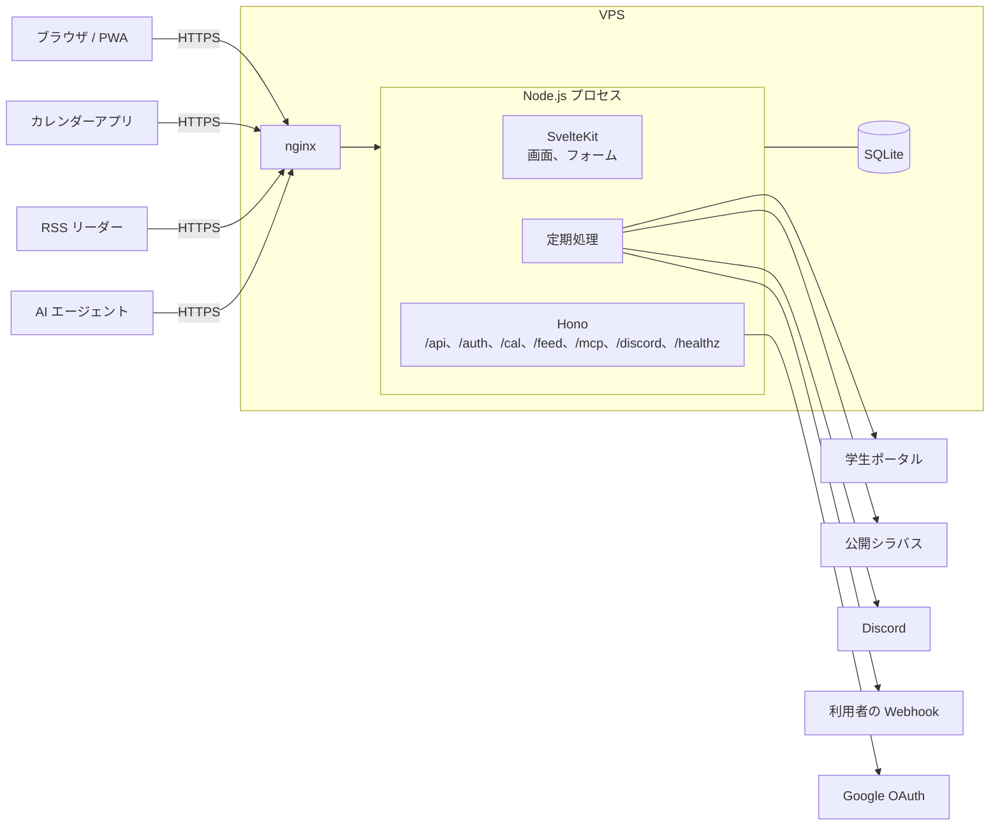

# 2. 構成

画面は SvelteKit、機械が呼ぶ口は Hono が受け持ちます。どちらも 1 つの Node.js のプロセスの中で動きます。



Funmary のために VPS の上で動かすのは、Node.js のプロセス 1 つだけです。HTTPS は VPS ですでに動いている nginx が受け持ちます。

- **SvelteKit** は人が見る画面を担当します。データの読み書きは `load` 関数とフォームアクションで行い、JavaScript が動かない環境でも主な操作ができるようにします
- **Hono** は機械が呼ぶ口を担当します。カレンダーアプリが取りに来る ICS、RSS リーダーが取りに来るフィード、公開 API と MCP、Google ログインのリダイレクト、Discord からのスラッシュコマンド、死活監視の `/healthz` がこれにあたります
- **定期処理** は同じプロセスの中で croner が起動します。OS の cron やジョブキューは使いません。外部のサービスに接続するのは定期処理だけで、画面や API の処理中には接続しません ([3.5](03-quality.md#35-壊れにくさとフォールバック))
- **データ** は SQLite のファイル 1 つに置きます。DB サーバーは立てません

## 2.1 Hono を採用する理由

SvelteKit の `+server.ts` だけでも API は書けます。それでも Hono を使うのは、機械向けの口に必要な部品がそろっているからです。

- ETag、セキュリティヘッダ、CSRF 対策、タイムアウトのミドルウェアが標準で入っています。ICS の `304 Not Modified` は ETag のミドルウェアで済みます
- フィードは hono-feed でそのまま配信できます
- `app.request()` でサーバーを起動せずにテストできます
- 画面と切り離しておけば、新しいクライアントや API を足すときも、画面側に手を入れずに済みます
- 依存がなく、小さいです

## 2.2 Hono は SvelteKit のフックから呼ぶ

別の HTTP サーバーは立てず、SvelteKit の `hooks.server.ts` で対象のパスだけ Hono に渡します。起動するサーバーは adapter-node の 1 つで済みます。

```ts
// apps/web/src/hooks.server.ts (簡略にしたもの)
const API_PATHS = ['/api', '/auth', '/cal', '/discord', '/feed', '/healthz', '/mcp', '/signup'];

export const handle: Handle = async ({ event, resolve }) => {
  const path = event.url.pathname;
  if (api && API_PATHS.some((prefix) => path === prefix || path.startsWith(`${prefix}/`))) {
    return api.fetch(event.request);
  }
  return resolve(event);
};
```

セッションの読み取りは `@funmary/auth` にまとめ、SvelteKit のフックと Hono のミドルウェアの両方から同じ関数を呼びます。

## 2.3 AI エージェントと外部のプログラム向けの口: 公開 API と MCP

利用者は、自分の時間割と休講を、AI エージェントや自作のスクリプト、iPhone のショートカットから読めます。AI エージェントは、Claude、ChatGPT、Cursor などを想定しています。「今日の授業は?」と聞けば、エージェントが Funmary に問い合わせて答えます。

### 2 つの口を、同じ処理の上に作る

| 口           | パス                     | 向いている使い方                                                                           |
| ------------ | ------------------------ | ------------------------------------------------------------------------------------------ |
| 公開 API     | `/api/v1/...` (JSON)     | スクリプト、ショートカット、ほかのアプリ。OpenAPI の定義があるので、呼び方を機械的に知れる |
| MCP サーバー | `/mcp` (Streamable HTTP) | AI エージェント。エージェントが道具 (tools) の一覧を読み、自分で選んで呼ぶ                 |

- どちらも Hono の上に置き、SvelteKit のフックから渡すパスに `/mcp` を足しています
- 読み取りの処理 (今日の授業、週の時間割、休講などの一覧、授業の詳細、通知欄) は 1 か所にまとめ、画面、公開 API、MCP から同じ関数を呼びます。口ごとに結果が食い違わないようにするためです
- 読み取りが中心です。書き込みは、書き込みの範囲を許可したトークンにだけ、自分の予定の追加、変更、削除、自分の履修 (履修登録、自分だけの曜日と時限、略称) の書き換えと、通知の既読を許します ([書き込み](#書き込み))。授業や科目など、共有のデータには書き込めません
- 画面や API と同じく、DB に保存済みのデータだけを返します。エージェントが何度問い合わせても、学生ポータルなど大学のサービスへの接続は増えません ([3.5](03-quality.md#35-壊れにくさとフォールバック))

### 公開 API と、内部の API を分ける

`/api/` の下には、画面が使う内部の API (未読数など) もあります。内部の API はログインの Cookie で認証し、形は予告なく変えます。公開 API は `/api/v1/` の下に分け、アクセストークンで認証し、形を保ちます。形を壊す変更は `/api/v2/` を作って行い、`v1` はしばらく残します。

| メソッドとパス                                                                 | 返すもの                                                                                   |
| ------------------------------------------------------------------------------ | ------------------------------------------------------------------------------------------ |
| `GET /api/v1/me`                                                               | トークンの持ち主の表示名と、許されている範囲 (scope)                                       |
| `GET /api/v1/lessons`                                                          | 日付または期間の授業。休講、補講、教室変更を反映したもの                                   |
| `GET /api/v1/lessons/next`                                                     | 次の授業 (授業中ならその授業)                                                              |
| `GET /api/v1/timetable`                                                        | 授業 (時刻つき) と、振替授業日、全学の休講日、祝日                                         |
| `GET /api/v1/timetable/week`                                                   | 週の曜日と時限の格子                                                                       |
| `GET /api/v1/periods`                                                          | 時限ごとの開始と終了の時刻                                                                 |
| `GET /api/v1/courses`                                                          | 履修登録した科目と、その曜日と時限                                                         |
| `GET /api/v1/academic-calendar`                                                | 年度の学期の期間と、祝日、全学の休講日、振替授業日                                         |
| `GET /api/v1/events`                                                           | 自分の予定と、時間割に加えた予定                                                           |
| `GET /api/v1/events/{id}`                                                      | 自分の予定を 1 件 (足すときと同じ形)                                                       |
| `POST /api/v1/events`                                                          | 自分の予定を足す (`write:events`)                                                          |
| `PUT /api/v1/events/{id}`                                                      | 自分の予定を置き換える (`write:events`)                                                    |
| `DELETE /api/v1/events/{id}`                                                   | 自分の予定を消す (`write:events`)                                                          |
| `POST /api/v1/courses`                                                         | 履修登録する。科目は年度とシラバスの番号か、名前で指す (`write:courses`)                   |
| `DELETE /api/v1/courses/{year}/{syllabusId}`                                   | 履修登録を取り消す (`write:courses`)                                                       |
| `PUT /api/v1/courses/{year}/{syllabusId}/personal-slots`                       | 自分だけの曜日と時限を足す (`write:courses`)                                               |
| `DELETE /api/v1/courses/{year}/{syllabusId}/personal-slots/{weekday}/{period}` | 自分だけの曜日と時限を消す (`write:courses`)                                               |
| `PUT /api/v1/courses/{year}/{syllabusId}/abbreviation`                         | 時間割に出す略称を保存する (`write:courses`)                                               |
| `GET /api/v1/status`                                                           | 休講などのデータが新しいか                                                                 |
| `GET /api/v1/subjects`                                                         | 科目の検索 (公開の科目だけ)                                                                |
| `GET /api/v1/subjects/{year}/{syllabusId}/sessions`                            | 科目の全授業日                                                                             |
| `GET /api/v1/changes`                                                          | 休講、補講、教室変更の一覧                                                                 |
| `GET /api/v1/subjects/{year}/{syllabusId}`                                     | 授業の詳細 (公開シラバスの内容、教員、教室、休講の履歴)                                    |
| `GET /api/v1/bus/stops`、`/bus/stops/{stopId}`、`/bus/next`                    | バスの停留所、発車表、次のバス (`read:transit`。[16 章](16-bus-timetable.md))              |
| `GET /api/v1/bus/legs`                                                         | 「A から未来大へ」「未来大から A へ」の発車 (`read:transit`。[16 章](16-bus-timetable.md)) |
| `GET /api/v1/notifications`                                                    | 通知欄                                                                                     |
| `POST /api/v1/notifications/{id}/read`                                         | 通知を 1 件、既読にする (`write:notifications`)                                            |
| `POST /api/v1/notifications/read`                                              | 未読をすべて既読にする (`write:notifications`)                                             |

### OpenAPI と Swagger UI

- 入出力の型は Valibot で書き、hono-openapi で OpenAPI 3.1 の定義を作ります。検証の型と文書が 1 つの定義から出るので、食い違いません
- 定義は `/api/v1/openapi.json` で配ります。クライアントの自動生成や ChatGPT の Actions など、ほかのツールにそのまま読ませられます
- `/api/docs` に Swagger UI を出します。文書のページには利用者のデータを載せないので、ログインなしで開けます
- 通知を送る Webhook の JSON の形は、同じ定義の `webhooks` に書いています

### MCP の道具

道具の定義 (名前、説明、引数、必要な範囲、処理) は、`packages/public/mcp` (npm の `@funmary/mcp`) に 1 つだけあります。処理は、データの取り出し口を通してだけ読み書きするので、サーバーの `/mcp` は DB から読む実装を、手元で動く MCP (stdio、`npx -y @funmary/mcp`) は `@funmary/client` を通して公開 API から読む実装を渡します。どちらでも、道具の中身は食い違いません。

| 道具                                                                        | 内容                                                                                                           |
| --------------------------------------------------------------------------- | -------------------------------------------------------------------------------------------------------------- |
| `get_lessons`                                                               | 日付か期間の授業 (時刻つき) と、振替授業日などを返す。日付を省くと今日                                         |
| `get_next_lesson`                                                           | 今の時刻から見た、次の授業                                                                                     |
| `list_events`                                                               | 自分の予定と、時間割に加えた予定                                                                               |
| `get_data_status`                                                           | 休講などのデータが新しいか                                                                                     |
| `search_subjects`                                                           | 科目の検索 (公開の科目だけ)                                                                                    |
| `get_subject_sessions`                                                      | 科目の全授業日                                                                                                 |
| `get_week`                                                                  | 週の曜日と時限の格子                                                                                           |
| `get_periods`                                                               | 時限ごとの開始と終了の時刻                                                                                     |
| `list_courses`                                                              | 履修登録した科目と、その曜日と時限                                                                             |
| `get_academic_calendar`                                                     | 年度の学期の期間と、祝日、全学の休講日、振替授業日                                                             |
| `list_changes`                                                              | 休講、補講、教室変更の一覧                                                                                     |
| `get_subject`                                                               | 授業の詳細                                                                                                     |
| `list_notifications`                                                        | 通知欄                                                                                                         |
| `list_bus_stops`、`get_bus_leg`、`get_bus_stop_timetable`、`get_next_buses` | バスの時刻表 (`read:transit`)                                                                                  |
| `get_event`                                                                 | 自分の予定を 1 件 (`update_event` に送り直せる形)                                                              |
| `create_event`                                                              | 自分の予定を足す (`write:events`)                                                                              |
| `update_event`                                                              | 自分の予定を置き換える (`write:events`)                                                                        |
| `delete_event`                                                              | 自分の予定を消す (`write:events`)                                                                              |
| `register_course`                                                           | 履修登録する。年度とシラバスの番号か、名前で指す。名前が複数に当たったら、登録せず候補を返す (`write:courses`) |
| `unregister_course`                                                         | 履修登録を取り消す (`write:courses`)                                                                           |
| `set_personal_slot`                                                         | 自分だけの曜日と時限を足す (`write:courses`)                                                                   |
| `remove_personal_slot`                                                      | 自分だけの曜日と時限を消す (`write:courses`)                                                                   |
| `set_subject_abbreviation`                                                  | 時間割に出す略称を保存する (`write:courses`)                                                                   |
| `mark_notification_read`                                                    | 通知を 1 件、既読にする (`write:notifications`)                                                                |
| `mark_all_notifications_read`                                               | 未読をすべて既読にする (`write:notifications`)                                                                 |

- 読み取りの道具には、読み取り専用の印 (`readOnlyHint`) を付けます。エージェントが確認なしに呼んでも、何も変わりません
- 書き込みの道具には、`readOnlyHint: false` を付けます。クライアントは、実行の前に利用者へ承認を求められます。置き換え (`update_event`) と削除 (`delete_event`) には、壊す操作の印 (`destructiveHint: true`) も付けます
- 結果は、機械が読める形 (`structuredContent`) と、人が読める短い文の両方で返します
- 公式の SDK (`@modelcontextprotocol/sdk`) と `@hono/mcp` を使います。SDK は道具の引数の型に zod を使うので、MCP の部分だけ zod が入ります。ほかの部分は Valibot のままにして、zod を持ち込みません

### 利用規約への同意

登録のあと、そして利用規約かプライバシーポリシーを更新したあとは、ログインしている全員に、同意の画面 (`/consent`) で同意を求めます。同意するまでは、すべての機能を止めます。

- 求める版は、2 つの文書の最終更新日 (`apps/web/src/lib/legal-versions.ts`) のうち、新しいほうの日付です。どちらかの日付を書き換えると、全員がもう一度同意します。同意した版と日時は利用者に持たせ、履歴は `terms_acceptances` に残します
- 画面 (`/app` と、API の同意の画面) は、同意の画面へ送ります。フォームの送信などは 403 です。同意のあとは、行こうとした画面へ戻ります
- 公開 API は、403 と `error: "terms_not_accepted"` を返します。トークンは正しいので 401 にはしません (クライアントが認証をやり直そうとしないため)。本文の `consentUrl` と、`Link` ヘッダに、同意の画面の URL を入れます
- MCP は、HTTP のエラーにしません。クライアントが、接続の失敗としか表示しないことが多いためです。データの道具の代わりに、同意が要ることと URL を答える道具を 1 つだけ出します
- Discord のコマンドは、答えの代わりに同意の画面を案内します。通知の配信と毎日のまとめは、同意するまで送らず、待たせておきます。カレンダーと RSS の購読は、403 と説明を返します
- 規約の本文 (`/terms`、`/privacy`)、ログイン、ログアウトは、同意の前でも使えます

履修の書き込み (`write:courses`) は、自分にしか効かないものだけを開けています。共有の枠 (ほかの利用者の時間割にも効く曜日と時限、教室) と、科目そのものは、API からは書き込めず、画面で行います。名前で科目を指したときは、完全に一致する科目が 1 つならそれを、なければ部分一致が 1 つならそれを選びます。複数に当たったら、何も書き込まず、候補を返します。

### 認証

個人用のアクセストークンで認証します。設定画面で発行し、`Authorization: Bearer <トークン>` で送ります。

- 名前 (どこで使うか)、範囲 (scope)、有効期限を付けて発行します。読み取りの範囲は `read:lessons`、`read:changes`、`read:notifications`、`read:transit`、書き込みの範囲は `write:events`、`write:courses`、`write:notifications` に分けています
- トークンは発行したときに 1 回だけ見せ、DB にはハッシュだけを保存します。最後に使った日時を記録し、設定画面の一覧からいつでも無効にできます
- 見分けやすいように先頭に `fmy_` を付けます。GitHub の secret scanning などで、誤って公開されたトークンに気づきやすくするためです
- Web 版の Claude や ChatGPT のコネクタは、OAuth での認可を前提にしています。この対応は、利用者が増えてから考えます

### 書き込み

AI エージェントが誤って、または乗っ取られて、利用者のデータを壊す事故を抑えるため、書き込みは読み取りと分けて、小さく始めています。

- **範囲を分けます**。書き込みの範囲 (`write:events`、`write:courses`、`write:notifications`) を持たないトークンは、書き込めません。範囲が指定されなかったときの既定は、読み取りの範囲だけです。同意の画面と発行の画面では、書き込みの範囲を、読み取りと分けて出し、初めはオフにします
- **自分のデータだけ**です。自分の予定と、自分の通知だけを書き換えます。ほかの人の予定は、見つからない (404) ことにします。授業、科目、管理の操作には書き込めません
- **公開範囲は変えられません**。足す予定は常に非公開で、置き換えても公開範囲は変わりません。誤って予定が公開される事故を防ぐためです
- **画面と同じ検査を通します**。予定の入力は、画面のフォームと同じ検査 (`@funmary/core` の `parseEventFields`) を通ります。名前の長さ、時刻の順、繰り返しの形などが、口ごとに食い違いません。直し方が分かる文を返します
- **置き換えです**。予定を直すときは、全体を送り直します (送らなかった項目は空になります)。先に `GET /api/v1/events/{id}` (または `get_event`) で今の内容を読み、変える項目だけを書き換えて送ります
- **削除は予定だけ**です。予定の削除は、元に戻せません。削除の道具には、壊す操作の印を付け、クライアントに承認を求めさせます。授業や通知の削除はありません
- **回数を厳しく制限します**。読み取りの 1 分に 60 回とは別に、書き込みは、トークンごとに 1 分に 20 回までです
- **履歴を残します**。書き込みのたびに、どのトークンが、何をしたかを `api_activity` に記録し、設定の「公開 API と MCP」の画面に出します。身に覚えのない書き込みに気づいたら、そのトークンを無効にします。履歴は 1 人につき最新の 200 件までで、古いものから消えます。トークンを無効にしても、履歴には残ります

### 守ること

- トークンで読めるのは、その持ち主のデータだけです。全体の休講の一覧も、ログインした利用者が画面で見られる範囲を超えません
- 回数制限を、トークンごとに hono-rate-limiter で掛けます (読み取りは 1 分に 60 回、書き込みは 1 分に 20 回)
- 公開 API と MCP には CORS を開けません。ほかのサイトのブラウザから呼ぶ使い方は想定しません。Cookie では認証しないので、CSRF の心配はありません
- 公開シラバスや休講の備考など、外から取り込んだ文は、決まった欄に**データとして**入れて返します。エージェントへの指示と取り違えられないように、文を道具の説明や見出しに混ぜません
- 利用者の時間割が、その人が使う AI の会社に渡ります。トークンの発行画面で、そのことを説明しています
- アクセストークンの発行と無効化は、管理用の通知ではなく、利用者の通知欄に記録します

## 2.4 npm で配るパッケージ

公開 API の上に、次の 3 つを npm で配ります (`packages/public/client`、`packages/public/mcp`、`packages/public/funmary`)。3 つは同じ版で、手で動かすワークフロー (`Publish npm`) から公開します。

| パッケージ        | 中身                                                                                                                                            |
| ----------------- | ----------------------------------------------------------------------------------------------------------------------------------------------- |
| `@funmary/client` | 公開 API の型付きのクライアント。型は OpenAPI の定義から作る                                                                                    |
| `@funmary/mcp`    | 手元で動く MCP サーバー (stdio)。サーバーの `/mcp` につなげないエージェントの受け皿                                                             |
| `funmary`         | 利用者向けのコマンド (`funmary login`、`funmary today` など) と、クライアントと MCP の組み立てを出すライブラリの入口 (`funmary`、`funmary/mcp`) |

- 道具の名前、説明、引数の型は 1 か所に書き、サーバーの `/mcp` と手元の MCP で共有します。リモートと手元で、道具の中身が食い違わないようにするためです
- 接続先の既定値は持ちません。本番のドメインをリポジトリに書かないためです。代わりに、トークンの発行画面に、URL とトークンを埋めた設定の例 (手元の MCP の設定と、`funmary login` のコマンド) を、コピーできる形で出します
- コマンドは、接続先とトークンを、OS の設定の置き場所に、自分だけが読める権限 (0600) で保存します。トークンは、画面にもログにも出さず、入力は表示せずに尋ねるか、標準入力から読みます。環境変数 `FUNMARY_URL` と `FUNMARY_TOKEN` は、保存した値より先に使います
- `@funmary/client` の型は、サーバーの OpenAPI の定義から作り (`pnpm generate:client`)、CI で作り直して、差分がないことを確かめます
- 公開は GitHub Actions から、npm の trusted publishing (OIDC) で行い、npm のトークンを secret に置きません
- VPS の管理用コマンドは、名前がぶつからないように `funmary-admin` としています
