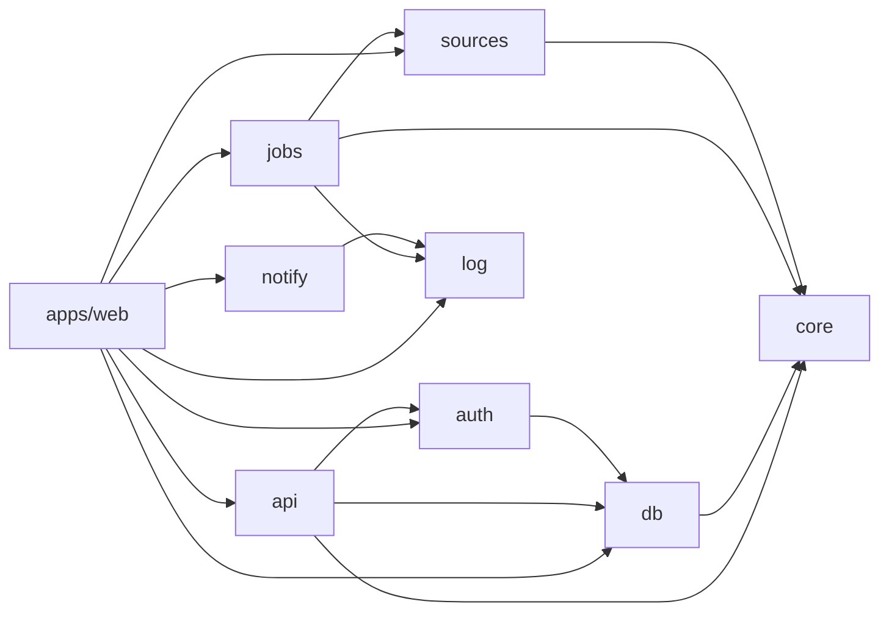

# 6. モノレポ構成

リポジトリは、画面のアプリ 1 つと、役割ごとに分けたパッケージで構成します。

```text
funmary/
├── apps/
│   └── web/           # SvelteKit。本番の入口 (server.ts) と、管理用コマンド (cli.ts) もここに置く
│       └── src/theme/ # SMUI のテーマ (ライト用とダーク用)
├── packages/
│   ├── public/        # npm に公開するパッケージ (3 つだけ。公開の手順は 5.6)
│   │   ├── client/    # @funmary/client: 公開 API の型付きのクライアント
│   │   ├── mcp/       # @funmary/mcp: MCP ツールの定義と、ローカルの MCP サーバー (stdio)
│   │   └── funmary/   # funmary: コマンドと、クライアント・MCP の公開 API
│   └── private/       # 公開しないパッケージ (すべて private)
│       ├── core/      # I/O のない処理: 時間割の展開、変更の検出、祝日と学期の判定
│       ├── db/        # スキーマ、マイグレーション、クエリ、暗号化とトークンの処理
│       ├── auth/      # Google ログイン、セッション、招待コード
│       ├── api/       # Hono のアプリ (/api、/auth、/cal、/feed、/mcp、/discord、/healthz)
│       ├── sources/   # 外部からの取得: 学生ポータル、公開シラバス、学年暦、祝日
│       ├── notify/    # 通知の送信: Discord、利用者の Webhook、管理者への通知
│       ├── jobs/      # 定期処理の実行と取得結果の記録
│       └── log/       # ログの出力
├── deploy/            # systemd の unit、nginx の設定、更新スクリプト
├── docs/              # 設計書 (この文書)、セルフホストの手順
├── scripts/           # ビルドとリリースの補助のスクリプト
├── AGENTS.md          # AI エージェントへの指示
├── CONTEXT.md         # 用語集。用語とコードの名前の対応
├── CONTRIBUTING.md    # 開発の決まり (コミットメッセージ、ブランチ、テスト)
├── pnpm-workspace.yaml
└── tsconfig.json
```

## 6.1 依存の向きは一方向にする



- `core` は I/O を持たず、現在時刻も引数で受け取ります。Vitest だけで確かめられます
- `api` は `notify` に依存しません。画面と API が処理中に外へ送信しない決まり ([3.5](03-quality.md#35-壊れにくさとフォールバック)) を、依存の向きでも守るためです
- `jobs` は `db` と `notify` に依存しません。定期処理が必要とする DB の読み書きや通知の送信は、引数 (`deps`) で受け取ります。つなぎ込みは `apps/web` が行います。これで、定期処理を DB なしでテストできます
- 新しいクライアントや機能を足すときは、`packages/private/` (公開しないもの) か `packages/public/` (npm に出すもの) に、新しいパッケージを足します。公開するかどうかは、ディレクトリで分かります。画面を変えずに済むようにするためです
