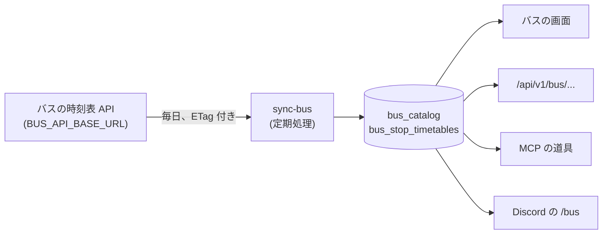

# 16. バス時刻表

函館バスの時刻表を、「バス」の画面、公開 API、MCP、Discord の `/bus` で見られます。バスの機能は、環境変数 `BUS_API_BASE_URL` を書いたサーバーだけで有効になります。書かなければ、メニューにも API にも出ません。

見せるのは、「選んだバス停 A から未来大へ」と「未来大から A へ」の便だけです。A は、未来大を通る任意のバス停です。

## 16.1 別の時刻表 API から取り込む

Funmary は、事業者のデータを自分では取りに行きません。「停留所ごとの発車表」を返す小さな API (契約は公開リポジトリ [hakobus-types](https://github.com/funmary-app/hakobus-types) の OpenAPI) から取り込みます。この API の実装は Funmary の外にあり、返すデータの権利は、実装する側が責任を持ちます。

- 契約は「停留所の一覧」と「停留所と版を指定した発車表」だけです。便をまたいで停留所をたどる情報 (GTFS の `stop_times` のようなもの) は持ちません
- 時刻表は「ダイヤの版」ごとに変わります。API は、改正の前から次の版を返せます。Funmary は、一覧にあるすべての版の発車表を保存し、日付に有効な版 (有効になる日が、その日以前のうち最も新しいもの) で答えます
- 発車表は、のりばと、平日 (`weekday`) か土曜、日曜、祝日 (`holiday`) の区分ごとに分かれています。祝日は、時間割と同じ祝日の表を使って決めます
- 24 時以降の発車 (`24:10` など) は、日付が変わったあとも前日のダイヤで数えます。金曜の深夜便は、土曜になっても平日のダイヤです

## 16.2 取り込み

定期処理 `sync-bus` が、毎日、日本時間の 5 時 30 分に動きます。ほかの取得元と同じく、取得元の見張り (名前は `bus`) で失敗を数え、続けて失敗したら試す間隔を広げて、管理用の通知で知らせます。`SOURCES_DISABLED` に `bus` を書くと止められます。

- 停留所の一覧と、一覧にある版 × 停留所の発車表を、前回の `ETag` を付けて取ります。変わっていなければ (304)、確かめた日時だけを更新します
- 取れなかった発車表があっても、取れた分は保存します。最後に、失敗として記録して知らせます
- API が「その版か停留所がない」(404) を返した発車表は、失敗にせず数えるだけです
- 一覧にない版と停留所の発車表は、取り込みのたびに捨てます
- 応答が契約の形と違ったときは (`schemaVersion` が 2 でない、時刻が `HH:MM` でないなど)、失敗として扱い、保存した内容は入れ替えません
- サーバーを起動したとき、まだ何も取り込んでいなければ、次の定期処理を待たず、1 回取り込みます
- 管理画面や管理用コマンドで手で動かしたときは、不調のあとの待ち時間を待たずに取ります (取得元が自前の API なので、原因を直したあとに、すぐ確かめられるようにするため)

保存するのは `bus_catalog` (一覧。行は 1 つ) と `bus_stop_timetables` (停留所と版ごとの発車表) です。どちらも、検査を通った JSON と `ETag`、API に最後に確かめた日時を持ちます。

## 16.3 向きと到着の時刻の決め方

時刻表の API には、便が次にどこへ行くかの並びがありません。そこで、発車表の「経由」と「行き先」の文字から、向きを決めます (`@funmary/core` の `filterByDirection`)。55 系統はどれも未来大を通るので、次のように決められます。

- **A から未来大へ**: A の発車のうち、行き先が「未来大へ向かう行き先」のもの。同じ行き先の便は同じ向きに進むので、経由に未来大と書かれた便が半分以上ある行き先を、未来大へ向かう行き先とします (経由は、一部の停留所しか書かれないため)
- **未来大から A へ**: 未来大の発車のうち、行き先が「A から未来大と反対へ向かう行き先」と同じもの、または、経由か行き先に A があるもの

**到着の時刻**は、到着する停留所の発車表から、同じ行き先で系統が重なる、あとの便 (45 分以内) を、時刻の順に 1 対 1 で結んで求めます (`matchArrivals`)。結べない便は、到着を出しません。

本物のデータの、医師会病院前と未来大の間の便は、Dotto の画面の時刻と一致することを確かめました。向きは文字から割り出したものなので、経由に書かれない停留所を通る便が、出ないことがあります。特に、未来大より赤川の側の停留所では、反対向きの便が混ざることがあります。

### 亀田支所前から先で、路線が分かれる

亀田支所前から先で、路線が二つに分かれます (五稜郭の側と、昭和の側)。選んだ停留所の側を通らない系統の便は、そのままでは出ません。そこで、選んだ停留所が通らない系統の便を、**亀田支所前と未来大の間の便**として足します。共通の区間なので、どちらの側の停留所を選んでいても乗れます。足した便は、「亀田支所前 - はこだて未来大学」のように、乗る停留所と降りる停留所を行ごとに出します。選んだ停留所が、亀田支所前そのものか、まだ発車表がないときは、足しません。

### 向きごとにバス停コードが分かれる停留所

同じ名前で、向きごとに別のバス停コードを持つ停留所があります (昭和営業所前、昭和1丁目など)。1 つのコードの発車表には、片方の向きの便しかありません。そこで、同じ名前 (全角と半角、空白の違いは無視) のコードの発車表をまとめて、1 つの停留所として向きを決めます。どちらのコードを選んでも、両方の向きの便が出ます。バス停の選択の一覧には、同じ名前を 1 つだけ出します。

## 16.4 画面

メニューの「設定」の 1 つ手前に「バス」を出します。操作は、学生向けのアプリ Dotto の画面を参考にしています。

- 上に、「出発」と「到着」の 2 つの欄を重ねます。片方は、いつも未来大です。もう片方 (A) を押すと、「バス停選択」の画面で、一覧から選びます。矢印のボタンで、出発と到着を入れ替えます
- 平日と休日を、2 つのタブで切り替えます。今日の区分には「(今日)」を付けます
- 一覧の各行は、「出発の時刻 → 到着の時刻」、系統と行き先 (「五稜郭行き」)、「乗る停留所 - 降りる停留所」と、のりばの名前です。まだ発車していない最初の便に、色を付けて「あと N 分」を出し、一覧をその位置に合わせます。発車の済んだ便は、薄く出します。1 分ごとに読み直します
- 840px 以上では、「次のバス」と出発・到着を縦に並べた経路指定を横に並べ、その下に、スマホと同じタブと時刻表を出します。時刻表の各便は、一覧の幅が 36rem 以上あれば横並びのコンパクトな一覧にし、それ未満ではスマホと同じ余白と文字サイズで縦に並べます (画面の幅で決めると、840px の近くで残り時間が切れるため)。横並びでは列幅を全便で共有し、時刻の長さや到着時刻の有無で系統やバスのアイコンの位置がずれないようにします。次のバスはホーム画面の次の授業と同じ、外枠のない角丸の表示です。経路と時刻表には枠を付けません。便の一覧だけをスクロールし、画面全体との二重スクロールを避けます。公式のアプリではないことの断りと規約などのリンクは、ほかの画面と同じく下に出し、いつも見えるようにします。840px 未満は従来の縦積み表示です
- 今日の区分では、一覧で色を付けた便と同じ便を「次のバス」に出し、残り時間も表示します。今日の最終便のあとは、翌日の便を出さずに「今日の発車は、もうありません」とします。今日と異なる区分を選んだときは、そのダイヤの最初の便を示し、実際の次便と誤認しないよう残り時間は出しません。選んだ向きと日の区分に合わせて情報を切り替えます
- ホームの「次のバス」も、バスの画面と同じく、開いたままのときは 1 分ごとに読み直します。発車した便のあとは次の便に替わり、「あと N 分」も進みます
- 選んだバス停は、Cookie に覚えて、次に開いたときも使います。平日と休日の選び方も Cookie に覚えますが、その日のうち (日本時間の 0 時まで) だけです。向きは、覚えません
- 向きと、平日と休日の切り替えでは、ページを読み直しません。選んだバス停の両方の向きと両方の日の種類を、まとめて画面に渡して、画面の中で切り替えます。URL に、バス停、向き、日の種類は付けません (週の時間割の「1 日/週」の切り替えと同じ作りです)
- **向きのはじめの値は、いる場所で決めます**。学内の Wi-Fi につながっていれば (接続元の IP アドレスが、環境変数 `CAMPUS_IP_RANGES` か、管理画面の「学内のネットワーク」で登録した範囲にあれば)、未来大から出る向きを出します。そうでなければ、未来大へ向かう向きです。ブラウザの現在地が許可されていれば、未来大の近く (500 m 以内) なら未来大から出る向き、離れていれば未来大へ向かう向きに決め直します。許可を、勝手には求めません。まだ許可していないときは、「現在地から向きを決める」のボタンを出します。矢印で入れ替えれば、いつでも変えられます
- 説明の文は、最小限にします。画面の下には、公式のサービスではない旨の 1 行だけを置きます。事業者の注意書き (印の意味) は、出しません。学内の Wi-Fi につながっているかや、向きの割り出しについての説明も、出しません
- 時刻表を最後に確かめてから 3 日以上たったときは、古いかもしれないと表示します。取り込む前は、まだ取り込めていないことを案内します
- 遅れや現在位置は出しません。時刻表の API が返すのは、決まった時刻表だけです

## 16.5 API、MCP、Discord

同じ読み取りの関数 (`packages/private/api/src/reads/bus.ts`) を、画面と各口が呼びます。範囲は `read:transit` です。バスの機能を使わないサーバーでは、API は 404 を返し、MCP の道具は出ません。

| 口                               | 内容                                                                                                                                    |
| -------------------------------- | --------------------------------------------------------------------------------------------------------------------------------------- |
| `GET /api/v1/bus/legs`           | 「A から未来大へ」「未来大から A へ」の発車。`stopId`、`direction` (`toUniversity` か `fromUniversity`)、`day`、`limit`。画面と同じ中身 |
| `GET /api/v1/bus/stops`          | 停留所と版の一覧                                                                                                                        |
| `GET /api/v1/bus/stops/{stopId}` | 停留所の発車表。`generation` を省くと、今日に有効な版                                                                                   |
| `GET /api/v1/bus/next`           | 今から先の発車。`stopId` を省くと強調する停留所。`limit` は 1 から 20                                                                   |
| MCP `get_bus_leg` ほか 3 つ      | `list_bus_stops`、`get_bus_stop_timetable`、`get_next_buses`。REST と同じ中身                                                           |
| Discord `/bus`                   | 亀田支所前と未来大の間の、2 つの向きの次の発車を、本人にだけ見せる                                                                      |

## 16.6 予定

- 便ごとの、通る停留所と時刻の表示 (時刻表の API の契約に、便をたどる情報が入ってから)
- 遅れと現在位置 (同じく、契約にその情報が入ってから)
- 向きの判定を、文字からではなく、系統ごとの停留所の並びから行う (契約に、並びを足してから)
